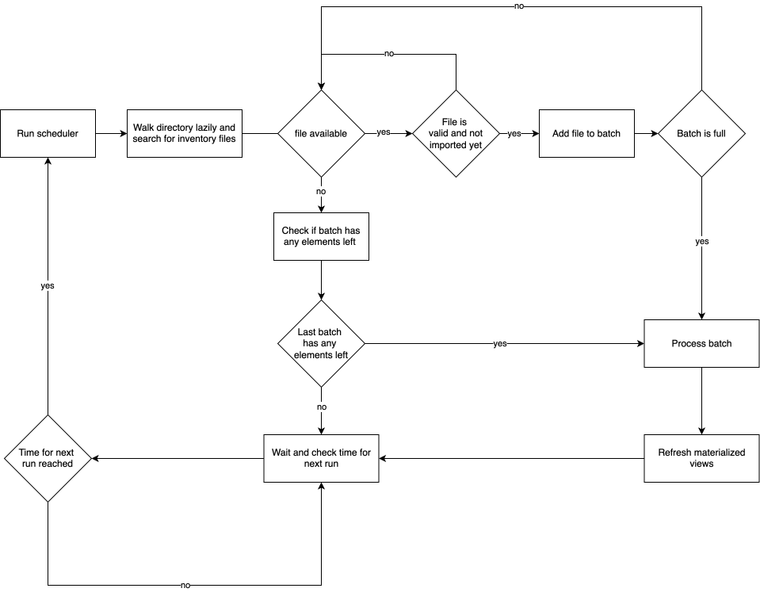
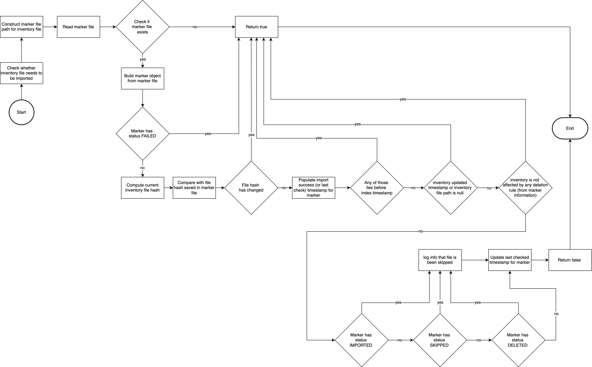

# Inventory Importer Service

## Introduction

The Inventory Importer Service module implements two schedulers with a specified cron that are responsible for importing (**import task**) and
deleting (**delete task**) inventories.

The **import task** is responsible for searching inventory files in the `Input directory` and importing them.
The inventories are collected and imported in batches of a size specified by the user.
If an inventory has already been imported or was deleted before by the **delete task** and its file hashes have not changed, it will be skipped and
not
persisted in the database again. Also, if any deletion rules apply to the inventory, it will not be imported either.
The `Input directory` can contain subdirectories, e.g. to group the inventories by a specific type (e.g. Keycloak, OpenSSL, etc.).

The **delete task** on the other hand is responsible for deleting inventories. This can be done according to three rules:

1. Maximum age (`max age`): inventories older than a specified period (e.g. 2 months, 34 days, 4 years, ...) will be deleted.
2. A list of asset group names (`asset group names`): inventories that are associated with any asset group name from the list of asset group names
   will be deleted.
3. A list of paths (`paths`): inventories that match a specific path pattern (specified in the glob pattern) will be deleted.

## Interfaces

Both scheduled tasks use properties that can be configured in the `env.rc` file. Those are described for each task in the following
sections.

### Shared Properties

The following properties are used by both, the **import task** and **delete task**.

#### Input directory

The **Input directory** specifies the directory path where the inventories that have to be persisted are located.
This can be configured by setting the `II_INPUT_DIR` property in the env.rc file (e.g. II_INPUT_DIR=input/inventories).
The inventories can be located either directly under the **Input directory** or in subdirectories. Symlinks are also supported.

The default value for this property is `input-inventories`.

`Note:` When working with symlinks, cycles are also detected. If a cycle is detected, the import task will terminate.

#### Marker directory

The **Marker directory** property defines the location in which the marker files for each inventory should be generated and stored.
This can be configured by setting the `II_MARKER_DIR` property in the env.rc file (e.g. II_MARKER_DIR=markers).

The default value for this property is `markers`.

#### Deletion rules

As previously mentioned, inventories can be deleted (by the **delete task**) or skipped (by the **import task**) by specifying three different rules
that are evaluated by the **import task** and **delete task**.

These are described in the following table:

| Rule                  | Environment variable             | Description                                                                                                                                                                                                                                                                                                                                                                                                                                                                                                                                                                                                                                       |
|:----------------------|:---------------------------------|:--------------------------------------------------------------------------------------------------------------------------------------------------------------------------------------------------------------------------------------------------------------------------------------------------------------------------------------------------------------------------------------------------------------------------------------------------------------------------------------------------------------------------------------------------------------------------------------------------------------------------------------------------|
| **max age**           | II_DELETE_RULE_INVENTORY_AGE_MAX | Inventories that are older than the specified max age (type **string**) will be deleted/skipped.  The age of the inventory is represented by the `updatedTimestamp` which is populated using the follwing fallbacks:  1. Enrichment timestamp  2. Inventory derived from Sbom creation timestamp 3. Sbom creation timestamp 4. Inventory last modified timestamp.  The max age has to be defined in human-readable format, for example "1 day", "30 minutes", "6 months", "2 years and 3 months", "2 years, 3 months" and so on.  This string will be converted internally to a matching timestamp of type `Instant`. | 
| **asset group names** | II_DELETE_RULE_ASSET_GROUP_NAMES | Inventories with the specified **list of** asset group names will be deleted/skipped (currently not supported).                                                                                                                                                                                                                                                                                                                                                                                                                                                                                                                                   | 
| **paths**             | II_DELETE_RULE_FILE_SYSTEM_PATHS | Inventories that match the specified **list of** path patterns will be deleted/skipped. These patterns are specified using glob patterns (https://www.malikbrowne.com/blog/a-beginners-guide-glob-patterns/).  Example: **src/\*\*/\*.xlsx** would match .xlsx files at any depth under src/ (a/inv1.xlsx, a/b/inv2.xlsx, ...).  However, ***.xlsx** would match inv1.xlsx and .xlsx, not src/inv1.xlsx.                                                                                                                                                                                                                                  |

All three rules must be defined using `""` in the `env.rc`.
By default, an empty string value for II_DELETE_RULE_ASSET_GROUP_NAMES and II_DELETE_RULE_FILE_SYSTEM_PATHS will be converted to an empty list and for
II_DELETE_RULE_INVENTORY_AGE_MAX it will be converted to null.

The following examples demonstrate, how to configure these rules and what they describe:

| Configuration                                                     | Description                                                                                          |
|:------------------------------------------------------------------|:-----------------------------------------------------------------------------------------------------|
| II_DELETE_RULE_INVENTORY_AGE_MAX=""                               | No max age configured, no inventories will be deleted/skipped for this rule                          | 
| II_DELETE_RULE_INVENTORY_AGE_MAX="6 months"                       | Inventories older than 6 months will be deleted/skipped                                              | 
| II_DELETE_RULE_INVENTORY_AGE_MAX="2 years, 4 months"              | Inventories older than 2 years and 4 months will be deleted/skipped                                  |
| II_DELETE_RULE_INVENTORY_AGE_MAX="1 week, 2 days and 12 hours"    | Inventories older than 1 week, 2 days and 12 hours will be deleted/skipped                           |
| II_DELETE_RULE_ASSET_GROUP_NAMES=""                               | No asset groups names configured, no inventories will be deleted/skipped for this rule               |
| II_DELETE_RULE_ASSET_GROUP_NAMES="assetGN1"                       | Inventories containing the asset group name "assetGN1" will be deleted/skipped                       |
| II_DELETE_RULE_ASSET_GROUP_NAMES="assetGN1, assetGN2"             | Inventories containing any of the asset group names "assetGN1" or "assetGN2" will be deleted/skipped |
| II_DELETE_RULE_FILE_SYSTEM_PATHS=""                               | No paths configured, no inventories will be deleted/skipped for this rule                            |
| II_DELETE_RULE_FILE_SYSTEM_PATHS="\*\*mongo\*\*"                  | Inventories with paths containing "mongo" will be deleted/skipped                                    |
| II_DELETE_RULE_FILE_SYSTEM_PATHS="\*\*mongo\*\*, \*\*openssl\*\*" | Inventories with paths containing "mongo" or "openssl" will be deleted/skipped                       |

### Import task

The **import task** uses properties that are necessary for importing and persisting the inventories.

#### Database URL

Describes which database is used. This URL can be configured via the `II_DATABASE_URL` property in the env.rc file.

#### User name

The name of the database user can be configured via the `II_DATABASE_USER_NAME` property in the env.rc file. This user is created during the setup
process and has limited permissions.

#### User password

The password for the database user can be configured via the `II_DATABASE_USER_PASSWORD` property in the env.rc file.

#### Index timestamp

The `indexTimestamp` indicates, when the index was last built and is used during the import process to check whether the inventory needs to be
imported. It ignores all marker files with an `importSuccessTimestamp`/`lastCheckTimestamp` older than the `indexTimestamp`.
This is necessary because each time a new index is built all the data in the database is cleared, and the database is left empty.
Consequently, existing marker files with the status `IMPORTED` are invalid and thus must be ignored when the import task
runs after the index is rebuilt. These marker files will then be overwritten by the new ones.
Therefore, the `indexTimestamp` value must always be set to represent the time when the index was last built.
Otherwise, there coud be markers that do not represent the actual status of the inventory file, which would lead to inconsistent information.
The `indexTimestamp` property is configured via the `II_IMPORT_INDEX_TIMESTAMP` property in the env.rc file.
This can be defined in the `ISO-8601` format, e.g. `2026-11-02T11:00:00Z`.

The default value for this property is `1970-01-01T00:00:00Z`.

`Note:`The timestamp must be defined in the UTC time (zulu time).

#### Batch size

Defines how many inventories will be imported and persisted simultaneously. By default, the batch size is set to 10.
It can be configured by setting the `II_IMPORT_BATCH_SIZE` property in the env.rc file.
After each batch of inventory is persisted, the materialized views are refreshed to ensure data consistency.

The default value for this property is `10`.

#### Max files per run

Defines the maximum number of inventory files to be processed in a task run.
It can be configured by setting the `II_IMPORT_MAX_FILES_PER_RUN` property in the env.rc file.

`Note:` inventories for which the import failed or that are already in the database are not counted.

The default value for this property is `500`.

#### Tenant ID

Describes who the tenant of the inventories is.
It can be configured by setting the `II_IMPORT_DEFAULT_TENANT_ID` property in the env.rc file.
this allows the same inventory to be persisted multiple times with different tenants.

#### Schedule

The scheduler that triggers the **import task** to start runs with a cron expression that defines the repeated execution time and can be
configured in the env.rc file by setting the`II_IMPORT_SCHEDULE` property.
For further information on how to create a cron expression visit https://crontab.cronhub.io/.
For example if the scheduler runs every minute, it triggers the **import task** to run each minute. However, if a scheduler that started the **import
task** from the previous minute is still running, the new scheduler is skipped.

#### Asset key mappings

The **import task** allows configuring a mapping for three asset keys to map to the metaeffekt asset keys.

The following table shows the mappable keys and their corresponding environment variables:

| Metaeffekt asset key | Environment variable                          | Description                                                                                                         |
|:---------------------|:----------------------------------------------|:--------------------------------------------------------------------------------------------------------------------|
| **externalAssetId**  | II_IMPORT_ASSET_KEY_MAPPING_EXTERNAL_ASSET_ID | Maps the defined key to the metaeffekt externalAssetId. The default value for this property is `External Asset Id`. | 
| **externalViewId**   | II_IMPORT_ASSET_KEY_MAPPING_EXTERNAL_VIEW_ID  | Maps the defined key to the metaeffekt externalViewId. The default value for this property is `External View Id`.   | 
| **pathInGroup**      | II_IMPORT_ASSET_KEY_MAPPING_PATH_IN_GROUP     | Maps the defined key to the metaeffekt pathInGroup. The default value for this property is `Path in Group`.         |

Each value of each of these variables can be a list of possible keys separated by commas. For example, the value could be `"Key1, Key 2, Key 3"`. Each
comma separated element will be seen as a string element in the list (including whitespaces).
In the example above, there are three keys: `"Key1"`, `"Key 2"` and `"Key 3"`.
The importer will map the first key in the list to the corresponding asset attribute for which a value is found. The order is therefore relevant and
defines the priority of the keys to be mapped.
For the example list `"Key1, Key 2, Key 3"` for externalAssetId mapping the importer would first try to map `"Key1"` to the externalAssetId.
If the inventory has a corresponding `"Key1"` attribute in the asset sheet, the value of that attribute would be returned and all other keys in the
list would be ignored, even if they were also valid.
If the inventory has no `"Key1"` asset attribute, the importer will try to find a `"Key 2"` attribute and so on. If the importer does not find any
mappable elements in the list, the value will be null.
By default, each list of the three mentioned lists has the metaeffekt asset key as the first element. Any other keys can be defined by adding
elements to the lists.

### Delete task

The **delete task** uses properties that are necessary for deleting inventories.

#### Schedule

Like the **import task** the **delete task** is also started by a scheduler that runs with a predefined cron. Its execution time can be configured in
the env.rc file by setting the `II_DELETE_SCHEDULE` property.

### Query service

The query service is responsible for processing user requests and loading the requested data from the database.
T improve database error and problem handling, three properties can be configured externally in the env.rc file, affecting parameters such as the
timeout or the pool size of the database connection.

#### Connection timeout

The database connection timeout determines how long a thread waits for a connection when all connections in the pool are acquired and none are
available until one is available again.
The timeout period is specified in milliseconds and can be configured in the env.rc file by setting the `II_DATABASE_CONNECTION_TIMEOUT` property.

#### Validation timeout

The database connection timeout defines how ling the system waits to check if a connection is valid. After this time has elapsed (in milliseconds),
the connection is regarded as invalid.
This can be configured in the env.rc file by setting the `II_DATABASE_VALIDATION_TIMEOUT` property.

#### Max pool size

The database max pool size defines the maximum number of connections in the pool.
This can be configured in the env.rc file by setting the `II_DATABASE_MAX_POOL_SIZE` property.

### Refresh of materialized views

The materialized views are refreshed at two points during the **import task**:

1. Once after a batch of inventories has been persisted
2. Once after all inventory batches have been persisted

For the **delete task**, the materialized views are refreshed at the end of a complete deletion run.

## Processing approach

The diagram below presents a compact and simplified view on the **import task**:

### Marker files

During both tasks (**import task** and **delete task**) marker files are generated for each inventory file. These files store the import
status of the file and some additional information used to check if the inventory is affected by any deletion rule when the deletion rules are
modified.

`Note:` a marker file is stored in the JSON format in the specified `Marker directory` and is named after the inventory file,
with the prefix being the relative path from the `Input directory` to that inventory file and the file ending being **.json**

#### Marker file attributes

This information is stored in the marker files:

| Attribute                     | Value type | Description                                                                                                                                                                                                                                                                                                                                                                              |
|:------------------------------|:-----------|:-----------------------------------------------------------------------------------------------------------------------------------------------------------------------------------------------------------------------------------------------------------------------------------------------------------------------------------------------------------------------------------------|
| **fileHash**                  | String     | The file hash of the inventory file to check if the file has changed.                                                                                                                                                                                                                                                                                                                    |
| **inventoryFilePath**         | String     | The file path of the inventory used to check the inventory against the `paths` deletion rule.                                                                                                                                                                                                                                                                                            |
| **inventoryUpdatesTimestamp** | Instant    | The updated timestamp of the inventory used to check the inventory against the `max age` deletion rule.                                                                                                                                                                                                                                                                                  |
| **lastCheckTimestamp**        | Instant    | The timestamp of the last time the file was accessed or modified for the import or delete task.                                                                                                                                                                                                                                                                                          |
| **importSuccessTimestamp**    | Instant    | The timestamp of the first time the file was successfully imported and persisted.                                                                                                                                                                                                                                                                                                        |
| **currentStatus**             | Status     | The current status of the import. The status can be one of the following:  `IMPORTED` (if the file was successfully imported),  `FAILED` (if the import/persistence failed),  `SKIPPED` (if the inventory matches a deletion rule and therefore is not imported) or  `DELETED` (if the inventory was deleted by the **delete task** because it matched a deletion rule). |
| **errorMessage**              | String     | The error message if the import of the file failed. If it was successfully imported, this will be null.                                                                                                                                                                                                                                                                                  |

Any attribute with a null value will not be included in the marker file.

#### Checking if inventory needs to be imported

When the **import task** finds an inventory file, it first checks if the file is valid and needs to be imported.
The following diagram shows the process of checking if an inventory needs to be imported or not:

In summary, the inventory will be imported if any of the following conditions are met (evaluated in the order listed):

1. The marker is null (does not exist) or it has the status `FAILED`.
2. The file hash of the inventory file has changed and does not match the file hash in its marker file.
3. The `importSuccessTimestamp` lies behind the `indexTimestamp` or the `lastCheckTimestamp` (in case the marker has the status `SKIPPED`) lies behind
   the `indexTimestamp`.
4. The `inventoryUpdatedTimestamp` or `inventoryFilePath` are null (in case we have an old marker that previously did not have those attributes
   the inventory will be imported again to update the marker and append the new attributes).
5. The inventory is not affected by any deletion rule (this is evaluated by reading the marker attributes for the inventory). 
In this case if the
   inventory already is in the database (marker file has status `IMPORTED`), it will be skipped during the import process (status of marker file stays
   `IMPORTED`). 
This condition also has the consequence that if an inventory was deleted previously by the **delete task** or skipped by the
   **import task** and the deletion rule changed, and the new deletion rule does not apply to that inventory anymore, it now will be imported. Its
   marker will be overwritten by the new marker having the status `IMPORTED`.

If one condition is met, the others will not be evaluated anymore and the inventory will be imported.

If none of the conditions apply, this means that the inventory is subject to a deletion rule and will therefore not be imported. The marker
file will not be modified, except for the `lastCheckTimestamp. It will be updated with the current timestamp value.

`Note:` if an inventory is deleted from the database manually, the corresponding marker file must also be deleted manually otherwise there will be
an inconsistency between the status of database and the status of the marker.
If the index was built from scratch, the corresponding `II_IMPORT_INDEX_TIMESTAMP` property in the `env.rc` file must be updated to reflect the
timestamp if the index build. This ensures that marker files with an `importSuccessTimestamp` or `lastCheckTimestamp` older than the latest index
timestamp are ignored.
Otherwise, the importer would not re-import the same inventory file again because a marker file with the status `IMPORTED` and the same file hash
already
exists for it.

#### Updating markers after import

Depending on the import status of the imported inventories, for each of them, the marker file is overwritten with the new values for each attribute.
In case the import fails, an error message is additionally appended to the marker file.

#### Updating markers after delete

After the **delete task** every marker file for the deleted inventory file is updated by updating the `lastCheckTimestamp` and setting the
`currentStatus` property to `DELETED`.