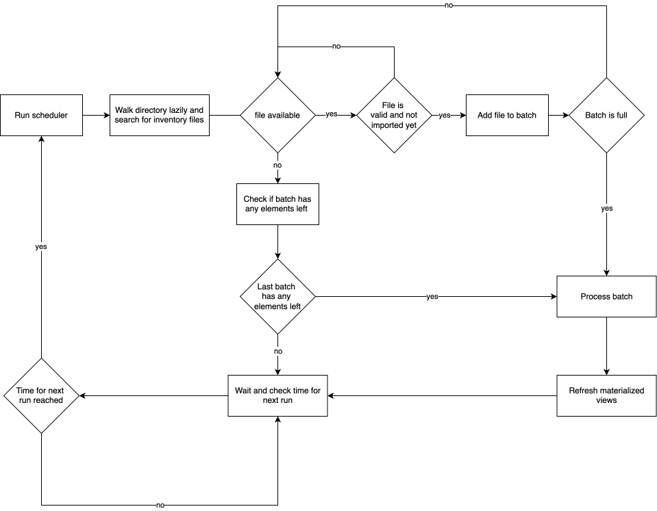
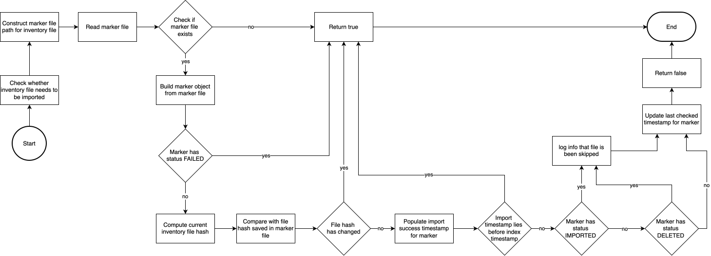

# Inventory Importer Service

## Introduction

The Inventory Importer Service module implements two schedulers that are responsible for importing (**import task**) and deleting (**delete task**)
inventories with a specified cron.

The **import task** is responsible for searching inventory files in the `input dir` directory and importing them.
The inventories are collected in batches with a predefined size and imported in batches.
If an inventory is already imported or was deleted before by the **delete task** and its file hashes did not change, it will be skipped and not
persisted in the database again.
The `input dir` can have subdirectories f.e. to group the inventories by a specific category (f.e. keycloak, openssl, ...).

The **delete task** on the other hand is responsible for deleting inventories. This can be done by three rules:

1. A maximum age: inventories older than a specified period (2 months, 34 days, 4 years, ...) will be deleted
2. A list of asset group names: inventories that are associated with a list of asset groups will be deleted
3. A list of paths: inventories with a specific path will be deleted.

## Interfaces

Both scheduled tasks use properties during the process that can be configured in the env.rc file. Those are described for both task in the following
sections.

### Shared Used Properties

The following two properties are used by both, the **import task** and **delete task**.

#### Input Dir

The Input Dir property specifies the directory where the inventories that have to be persisted are located.
It can be configured by setting the `II_INPUT_DIR` property in the env.rc file.
The inventories can be located directly under the input dir or under subdirectories. Symlinks are also supported.

`Note:` When working with symlinks, cycles are also detected. If a cycle is detected, the import task will terminate.

#### Marker Dir

The Marker Dir property defines the directory where the marker files for each inventory should be generated and stored.
It can be configured by setting the `II_MARKER_DIR` property in the env.rc file.

### Import task

The **import task** uses properties that are necessary for importing and persisting the inventories.

#### Database URL

The database URL describes which database is used. This URL can be configured via the `II_DATABASE_URL` property in the env.rc file.

#### User name

The name of the database user can be configured via the `II_DATABASE_USER_NAME` property in the env.rc file. This user will be created during
the setup process and has limited permissions.

#### User password

The password for the database user can be configured via the `II_DATABASE_USER_PASSWORD` property in the env.rc file.

#### Index timestamp

The index timestamp defines, when the index was build the last time and is used during the import process (when checking if
the inventory needs to be imported or not) to ignore all marker files having an import timestamp older than the index timestamp.
This is necessary because with each time a new index is built all data from the database gets cleared, and it is empty again.
As a consequence, existing marker files with the status `IMPORTED` are invalid and thus have to be ignored when the import task
runs after the index is rebuilt.
The index timestamp property can be configured via the `II_IMPORT_INDEX_TIMESTAMP` property in the env.rc file.
It can be defined using the `ISO-8601` format, f.e. `2026-11-02T11:00:00Z`.

`Note:`The timestamp must be defined in the UTC time (zulu time).

#### Batch size

The batch size defines how many inventories will be imported simultaneously and then persisted. By default, the batch size is set to 10.
It can be configured by setting the `II_IMPORT_BATCH_SIZE` property in the env.rc file.
After each inventory batch is persisted, the materialized views are refreshed to ensure data consistency.

#### Tenant ID

The tenant ID property describes who the tenant of the inventories is.
It can be configured by setting the `II_IMPORT_DEFAULT_TENANT_ID` property in the env.rc file.
With this, the same inventory can be persisted multiple times with different tenants.

#### Schedule

The scheduler used in the **import task** runs with a cron expression that defines the repeated execution time and can be
configured in the env.rc file by setting the`II_IMPORT_SCHEDULE` property.
For further information on how to create a cron expression visit https://crontab.cronhub.io/.
For Example if the scheduler runs every minute, each minute it triggers the **import task** to run. If a scheduler that has started the **import task
** from the minute before is still running, the new scheduler is skipped.

#### assetKeyMappings

The **import task** allows configuring a mapping for three asset keys to map to the metaeffekt asset keys.
The following table shows the mappable keys and the corresponding environment variables:

| Metaeffekt asset key | Environment variable                          | Description                                            |
|:---------------------|:----------------------------------------------|:-------------------------------------------------------|
| **externalAssetId**  | II_IMPORT_ASSET_KEY_MAPPING_EXTERNAL_ASSET_ID | Maps the defined key to the metaeffekt externalAssetId | 
| **externalViewId**   | II_IMPORT_ASSET_KEY_MAPPING_EXTERNAL_VIEW_ID  | Maps the defined key to the metaeffekt externalViewId  | 
| **pathInGroup**      | II_IMPORT_ASSET_KEY_MAPPING_PATH_IN_GROUP     | Maps the defined key to the metaeffekt pathInGroup     |

Each value of those variables can be a list of possible keys separated by comma, f.e. `"Key1, Key 2, Key 3"`. Each comma separated elements will be
seen
as a string element in the list (including whitespaces).
In this example there are three Keys: `"Key1"`, `"Key 2"` and `"Key 3"`.
The importer will map the first key in the list for that a value is found to the corresponding asset attribute. Here the order is relevant and defines
the priority of the keys to be mapped.
For the example list `"Key1, Key 2, Key 3"` for externalAssetId mapping the importer first would try to map `"Key1"` to the externalAssetId.
If the inventory has a corresponding `"Key1"` attribute in the asset sheet, the value of that attribute would be returned and all other keys in the
list would be ignored (even if those were valid too).
If the inventory has no `"Key1"` asset attribute, the importer would try to find a `"Key 2"` attribute and so on. If the importer does not find any
mappable element in the list, the value will be null.
By default, each list of the three mentioned variables has the metaeffekt asset key as the first element. Any other key(s) can be defined by adding
element(s) to the lists.

### Delete task

The **delete task** uses properties that are necessary for deleting the inventories.

#### Schedule

Like the **import task** the **delete task** also is started by a scheduler that runs with a predefined cron. Its execution time can be configured in
the env.rc file by setting the `II_DELETE_SCHEDULE` property.

#### Rules

As mentioned before, inventories can be deleted depending on three different rules. Those are described in the following table:

| Rule                  | Environment variable             | Description                                                                             |
|:----------------------|:---------------------------------|:----------------------------------------------------------------------------------------|
| **max age**           | II_DELETE_RULE_INVENTORY_AGE_MAX | Inventories older than the specified max age will be deleted (f.e. older than 2 months) | 
| **asset group names** | II_DELETE_RULE_ASSET_GROUP_NAMES | Inventories with the specified (list of) asset group names will be deleted              | 
| **paths**             | II_DELETE_RULE_FILE_SYSTEM_PATHS | Inventories with the specified (list of) paths will be deleted                          |

`Note:` An empty string value for II_DELETE_RULE_ASSET_GROUP_NAMES and II_DELETE_RULE_FILE_SYSTEM_PATHS will by default converted to an empty list.

Besides this, currently it is not recommended to modify the deletion rules after the index is build and the **index timestamp** is defined at that
time.
The reason for this is that it can lead to ignore importing inventory candidates with existing markers (that now should be imported depending on the
deletion rule) because any marker having an **import timestamp** laying after the **index timestamp** will be considered to not be imported.
This is due to the fact that a marker file for that inventory candidate already exists and that inventory is (according to the deletion rule defined
when the index was build the last time and the **index timestamp** was set) either already imported (marked IMPORTED) or was imported
and then deleted (marked DELETED).
This will be fixed in the next version.

### Query service

The query service is responsible for processing user requests and loading the requested data from the database as a result.
For better database error and problem handling three properties can be configured externally in the env.rc file that effect for example the timeout or
the pool size of the database connection.

#### Connection timeout

The database connection timeout determines how long a thread waits when all connections in the pool are acquired and no one is available until one is
available again.
The time is specified in milliseconds and can the configured in the env.rc file by setting the `II_DATABASE_CONNECTION_TIMEOUT` property.

#### Validation timeout

The database connection timeout defines the waiting time for checking if a connection is valid. After the defined time (in milliseconds) the
connection is regarded invalid.
It can be configured in the env.rc file by setting the `II_DATABASE_VALIDATION_TIMEOUT` property.

#### Max pool size

The database max pool size defines the max number of connections in the pool.
It can be configured in the env.rc file by setting the `II_DATABASE_MAX_POOL_SIZE` property.

### Refresh of Materialized views

The refresh of the materialized views happens at two moments during the **import task**:

1. Once after a batch of inventories is persisted
2. Once after all inventory batches are persisted

For the **delete task** the materialized views are refreshed at the end of a complete deletion run.

## Processing approach

The diagram below presents a compact and simplified view on the **import task**:

### Marker files

During both tasks (**import task** and **delete task**) marker files are generated for each inventory file and used to store the status of the file
and some additional information.

`Note:` A marker file is stored in the JSON format in the specified `marker dir` and has the same name as the inventory file
with the relative path from the `input dir` to that inventory file as the prefix and with the additional file ending **.json**

#### Marker data

This information is stored in the marker files:

| Data                       | Value type | Description                                                                                                                                                                                                                             |
|:---------------------------|:-----------|:----------------------------------------------------------------------------------------------------------------------------------------------------------------------------------------------------------------------------------------|
| **fileHash**               | String     | The file hash of the inventory file to check if the file has changed                                                                                                                                                                    |
| **lastCheckTimestamp**     | Instant    | The timestamp of the last time the file was accessed or modified for the import or delete task                                                                                                                                          |
| **importSuccessTimestamp** | Instant    | The timestamp of the first time the file was successfully imported and persisted                                                                                                                                                        |
| **currentStatus**          | Status     | The current status of the import. This can be either:  `IMPORTED` (if the file was successfully imported),  `FAILED` (if the import/persistence failed) or  `DELETED` (if the inventory was deleted by the **delete task**) |
| **errorMessage**           | String     | The error message if the import of the file failed, otherwise if it was successful this will be null                                                                                                                                    |

#### Checking if inventory needs to be imported

When the **import task** finds an inventory file, it first checks if the file is valid and needs to be imported.
The following diagram shows the process of checking if an inventory needs to be imported or not:

Consequently, if an inventory was deleted previously by the **delete task** it will not be imported again, because its marker file has
the status`DELETED`(Unless its file hash changes, then it is considered a new file and will be imported and
the old marker file will be overwritten with the new import timestamp and new file hash.)

`Note:` If an inventory is deleted from the database manually, the corresponding marker file has to be removed by hand.
If the index is build from scratch, the corresponding `II_IMPORT_INDEX_TIMESTAMP`
property must be refreshed by setting the timestamp of the latest index build, so that marker files older than the latest index timestamp are ignored.
Otherwise, the importer would not import the same inventory file (with unchanged file hash) again
because a marker file with the status `IMPORTED` and the same file hash already exists for it.

#### Updating markers after import

Depending on the import status of the imported inventories, for each of them, the marker file is updated with the new file hash, the import status and
import timestamp. In case the import fails, an error message is additionally appended to the marker file.

#### Updating markers after delete

After the **delete task** every marker file for the deleted inventory file is updated by setting the `currentStatus` property to `DELETED`.