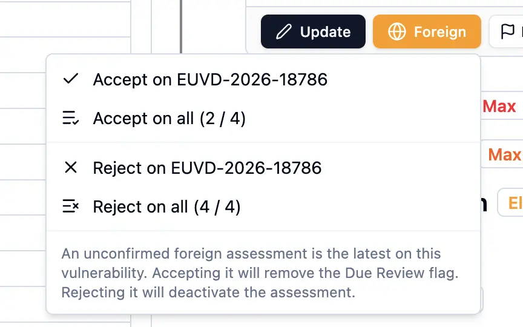
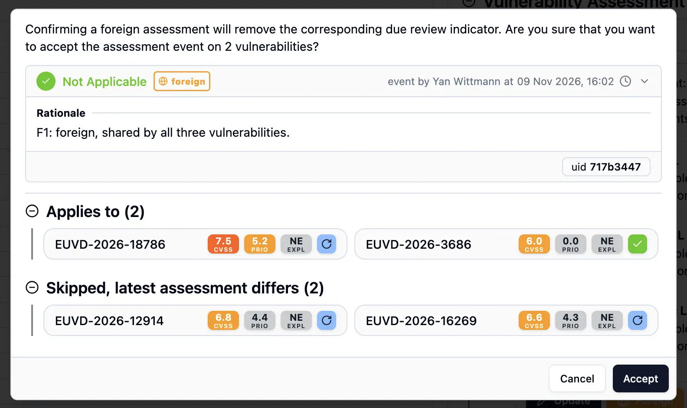
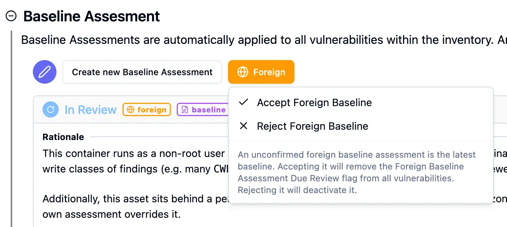
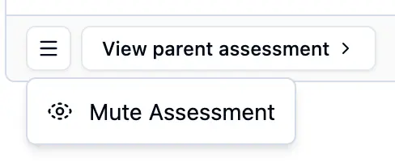
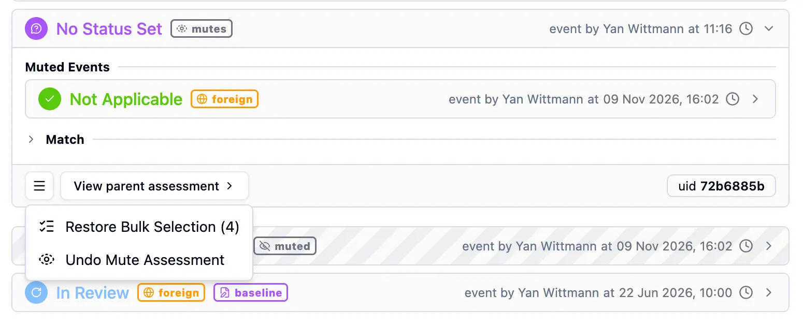
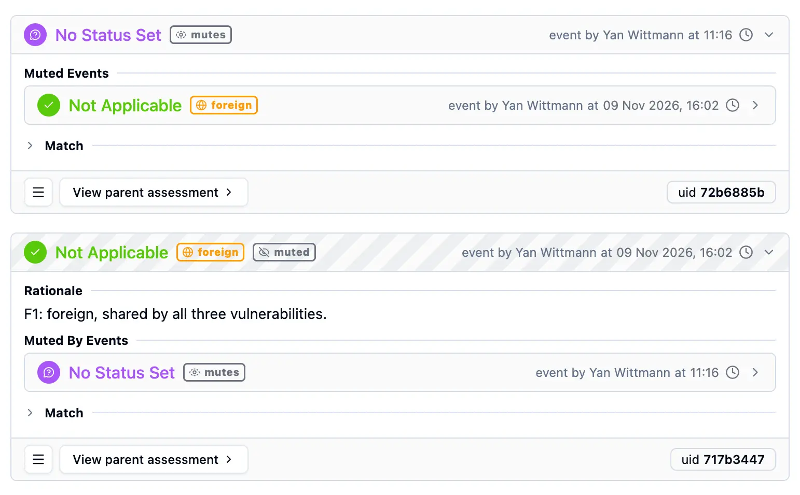
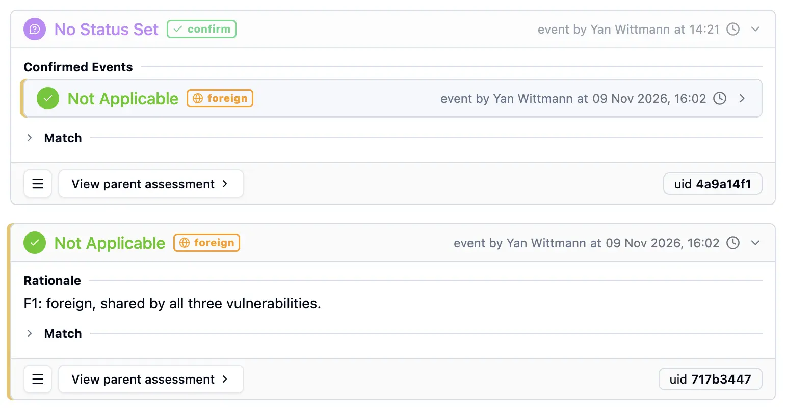

> [Documentation](../../../../README.md) >
> [Vulnerability Management](../../../README.md) >
> [Reports](../../README.md) >
> [Assessment Dashboard](../README.md) >
> Due Review

# Concept: Due Review

> [Overview](#overview) -
> [Reasons](#reasons) -
> [Mute and Confirm Events](#mute-and-confirm-events) -
> [Resolving Foreign Assessments](#resolving-foreign-assessments) -
> [Sorting and Priority](#sorting-and-priority)

## Overview

The "Due Review" column in the vulnerability table flags vulnerabilities that require attention from a reviewer.
It is a computed, read-only indicator that the dashboard derives from the current state of the assessment events and the active security policy.
It does not change the effective assessment of a vulnerability.

Each reason is represented by an icon in the column cell.
Hovering over the cell shows a tooltip listing all active reasons along with a context message explaining why each reason is triggered.

## Reasons

There are four defined reasons for a Due Review state, which can each be active independently:

### No Manual Assessment (`NO_MANUAL_ASSESSMENT`)

A vulnerability receives this reason when no manual, vulnerability-scoped, non-foreign assessment event has been created for it.
This means the vulnerability is assessed only via a baseline (inventory-scope) assessment, a foreign assessment, an automated assessment, or not at all.

### Review Period Expired (`REVIEW_PERIOD`)

A vulnerability receives this reason when its most recent manual assessment event is older than the period configured in `assessmentReviewPeriod` in the [Central Security Policy](../../../technical-specifications/algorithms-calculations/security-policy/central-security-policy.md).
This ensures that assessments are regularly revisited as the threat landscape evolves and new information becomes available.
If `assessmentReviewPeriod` is not configured, this reason is never triggered.

### Foreign Assessment (`FOREIGN_ASSESSMENT`)

A vulnerability receives this reason when its latest vulnerability-scoped assessment event originates from a foreign source, meaning it was originally created for a different asset and has been propagated to the current one.
The context template can be configured through the `sourceAssessmentContextPattern` in the [Central Security Policy](../../../technical-specifications/algorithms-calculations/security-policy/central-security-policy.md).
The tooltip shows the asset Id and context information of the foreign source when available.
How to resolve it is described in [Resolving Foreign Assessments](#resolving-foreign-assessments).

### Foreign Baseline Assessment (`FOREIGN_BASELINE_ASSESSMENT`)

This reason is similar to `FOREIGN_ASSESSMENT`, but applies to inventory-scope (baseline) assessments rather than vulnerability-scoped ones: it is raised when the latest baseline assessment event is foreign.
A newer vulnerability-scoped event does not resolve it, since both reasons are decided separately per scope.

## Mute and Confirm Events

Since [assessment format version 2.4](../../../technical-specifications/formats/assessment/vulnerability-assessment-file-gen-4-2.4.md), an event can mute other events, which switches them off, or record that it confirms other events.
The Due Review treats them as follows:

- Mute events and the events they mute are ignored by all four reasons, as if they did not exist.
  A mute event therefore neither counts as a manual assessment nor resets the review period, and a muted foreign event cannot raise a foreign reason.
- Confirm events are regular local events and count as usual.

## Resolving Foreign Assessments

A foreign due review reason asks the reviewer to decide whether the foreign assessment should apply to the current asset.
The dashboard offers two answers, both of which create a new assessment and require being logged in to the dashboard API.

- **Accept** creates an empty local event that confirms the foreign event.
  The foreign event keeps counting, so the effective assessment stays the same, but it is no longer the latest event and the reason is resolved.
- **Reject** creates a local event that mutes the foreign event.
  The foreign event stops counting, and the effective assessment falls back to the events before it.
  If the latest remaining event is foreign as well, the reason stays and now points to that event.

Both target exactly the foreign event the reason points to, which is shown in the confirmation dialog.

### On a vulnerability

The effective assessment of a vulnerability with a `FOREIGN_ASSESSMENT` reason shows a "Foreign" button with the following options:

- "Accept on" / "Reject on" the current vulnerability.
- "Accept on all" / "Reject on all" vulnerabilities the foreign assessment applies to, shown with the number of vulnerabilities it will apply to.
  Accepting on all only includes vulnerabilities where the same foreign event is still the latest one, rejecting on all only includes vulnerabilities that still have a foreign reason, and the confirmation dialog lists the others as skipped.

<table>
<thead><tr><th>Drop-Down in Vulnerability Sheet</th><th>Dialogue "Accept on all"</th></tr></thead>
<tbody>
<tr>
<td>

</td>
<td>

</td>
</tr>
</tbody>
</table>

### On the baseline

A vulnerability with a `FOREIGN_BASELINE_ASSESSMENT` reason shows a foreign marker in its effective assessment header that leads to the Metadata tab.
There, next to "Create new Baseline Assessment", a "Foreign" button offers "Accept Foreign Baseline" and "Reject Foreign Baseline".
A baseline applies to all vulnerabilities, so both act on all of them at once.

<table>
<thead><tr><th>Foreign dropdown on the Metadata tab</th></tr></thead>
<tbody>
<tr><td>

</td></tr>
</tbody>
</table>

### On a single event

Any assessment event can be muted through the menu in its footer ("Mute Assessment"), and a mute event can be undone the same way ("Undo Mute Assessment").
This is not limited to foreign events.
On a vulnerability-scoped event, the mute only applies to the vulnerability the event is currently shown for.

<table>
<thead><tr><th>Mute Button on any Event</th><th>Undo Mute Button on Bulk Assessment Event</th></tr></thead>
<tbody>
<tr>
<td valign="top">

</td>
<td>

</td>
</tr>
</tbody>
</table>

### Examples

<table>
<thead><tr><th>Assessment muting a foreign assessment</th></tr></thead>
<tbody>
<tr><td>

</td></tr>
</tbody>
<thead><tr><th>Assessment confirming a foreign assessment, while the user hovers over the confirmed assessment</th></tr></thead>
<tbody>
<tr><td>

</td></tr>
</tbody>
</table>

## Sorting and Priority

When sorting by the Due Review column, the dashboard assigns a weight to each reason and sorts by the total weight of all active reasons for each vulnerability.
The weights are ordered from highest to lowest urgency as follows:

1. `FOREIGN_ASSESSMENT`
2. `REVIEW_PERIOD`
3. `NO_MANUAL_ASSESSMENT`
4. `FOREIGN_BASELINE_ASSESSMENT`
