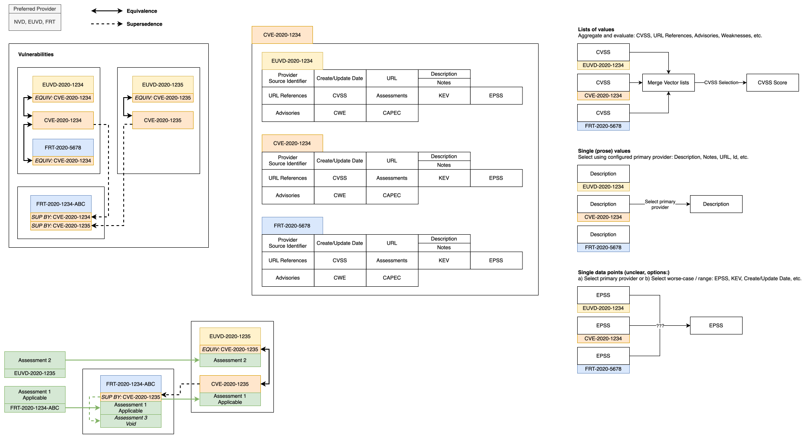

> [Documentation](../../../../README.md) >
> [Vulnerability Management](../../../README.md) >
> [Technical Specifications](../../README.md) >
> [Inventory](README.md) >
> Vulnerability Relationships

# Vulnerability Relationships

A representation is the entry of a single provider for a vulnerability, such as `CVE-2020-1234` from NVD or `EUVD-2020-1234` from EUVD.
Representations reference each other through typed vulnerability references, the `ref` property of a reference holds the relationship type.

## Equivalence (`equivalent`)

Equivalent representations describe the same real-world vulnerability and are grouped into one composite vulnerability, which is written as a single row of the [Vulnerabilities](inventory-sheet-vulnerabilities.md) worksheet.

The relationship is bidirectional and transitive, so if `A` is equivalent to `B` and `B` to `C`, all three end up in the same composite.
It only has to be stated on one of the representations.

Equivalence is established in the following cases:

- A representation carries an `equivalent` reference to another vulnerability.
- Two representations from different providers share the same id.

Once several representations are stored together in the `Representations` cell of a single row, that inventory will consider then to be equivalent forever, as there is currently no mechanism to undo this relationship type.

A reference to a vulnerability that is not part of the inventory yet is remembered and applied as soon as that vulnerability is added.

## Supersedence (`superseded-by`)

A representation can be superseded by one or more other vulnerabilities that replace it going forward.
Unlike equivalence, supersedence does not group representations, the superseded and the superseding vulnerability remain separate composites.

As soon as a superseding vulnerability is present in the inventory, multiple things are triggered:

- the superseded composite receives a `void` status assessment.
- the superseding representation inherits the assessments of the entire chain of vulnerabilities it supersedes, so that an assessment written for the superseded vulnerability continues to apply.

In the diagram above, `Assessment 1` written for `FRT-2020-1234-ABC` therefore also applies to the composite of `CVE-2020-1235`.

The relationship is visible in the `Superseded By` and `Supersedes` columns of the [Vulnerabilities](inventory-sheet-vulnerabilities.md) worksheet.

## Effective Values of a Composite

A composite has no data of its own, every value is computed from its representations.
How the values are combined depends on their type.

- Lists of values, such as CVSS vectors, references, security advisories, weaknesses and tags, are merged across all representations.
- Single prose values, such as the description, notes and URL, are taken from the first representation that provides one, in the provider priority order configured in the [security policy](../../algorithms-calculations/security-policy/central-security-policy.md) (`vulnerabilityRepresentationProviderPriority`).
- Single data points are combined individually.
  The KEV data uses the worst case across all representations, the EPSS data follows the provider priority, the creation date is the earliest and the update date the latest of all representations.
